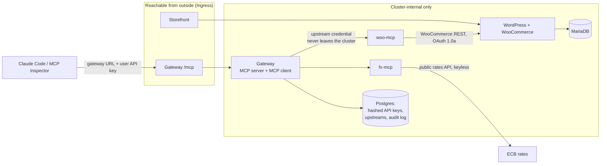

# MCP Gateway on Kubernetes

A WooCommerce store, the MCP servers that act on it, and one gateway that gives a
team access to those tools through a single endpoint and a single key per person.

Everything runs in a Kubernetes cluster. The same Helm charts run on a local
cluster and on a k3s VPS, with the differences held in values files only.

## The problem

A team runs an online store. The people on it want to use AI tools against that
store: create a product, look up today's orders, change an order status, ask a
question in plain language and have the right tool called.

MCP is the protocol for that. The usual way to get there is for every person to
configure every MCP server in their own client. That breaks down fast:

- **Credentials spread.** The store's API key ends up in a config file on every
  laptop. Rotating it means chasing everyone.
- **No central control.** Nobody can add a server for the whole team, or turn one
  off, without each person editing their own setup.
- **No attribution.** The store sees one API key. It cannot tell who created the
  product or who changed the order.
- **Every client needs the topology.** Each person has to know the internal URL of
  each server, so those servers have to be reachable from outside the cluster.

So the upstream credential and the server list belong on a server, not on a
laptop. That server is what this project builds.

## What this builds

A gateway that is two things at once:

- **An MCP server** to every team member and every MCP client. One URL, one key
  per person.
- **An MCP client** to every upstream MCP server behind it.

A client sends the gateway a key and gets back the tools of every enabled
upstream. It never learns an upstream URL and never holds an upstream credential.
The gateway holds those, routes each call to the right server, and writes an
audit row for every call naming the user who made it.



## The pieces

### Store

WordPress and WooCommerce with MariaDB, in the cluster. Own Helm templates over
the official images, not a third-party chart, so the bring-up is ours to
understand and to fix (D-005). WordPress content and the database each have a
PersistentVolumeClaim, so pods can be deleted without losing the store.

A bootstrap Job installs WooCommerce, creates a sample product, and inserts the
REST API key pair that woo-mcp uses. The Job is idempotent: every step that
changes state logs a SKIP when the state is already there, so `helm upgrade` is
safe to re-run.

### woo-mcp

The WooCommerce MCP server, written here from scratch. Streamable HTTP, Python,
the official MCP Python SDK (D-007). Five tools:

| Tool | What it does |
|---|---|
| `list_products` | List products |
| `create_product` | Create a product with a name and a price |
| `list_orders` | List orders, optionally filtered by date |
| `get_order` | One order by id |
| `update_order_status` | Move an order to another status |

It has no Ingress and a NetworkPolicy that allows ingress only from pods labelled
`app.kubernetes.io/name: gateway`. Nothing else in the cluster reaches it, not
even the storefront. The gateway is the only way in.

It talks to the store over the WooCommerce REST API with OAuth 1.0a over plain
HTTP inside the cluster (D-006). That API has a trap worth knowing about:
WooCommerce builds its signature base string from `get_home_url()`, not from the
Host header and not from the address the client dialled. So woo-mcp dials the
cluster-internal Service and signs the store's public home URL. They are two
different values in `charts/woo-mcp/values.yaml` for that reason, and a unit test
pins the behaviour, because a wrong signature looks exactly like a wrong
credential and sends you hunting in the wrong place.

### fx-mcp

A second upstream, deliberately different from the first. Two tools, `rates` and
`convert`, over a public exchange rate API that needs no key.

It exists to make the gateway handle both shapes of upstream: one that needs a
stored credential and one that needs none. It also makes cross-server questions
possible, like converting today's order total into another currency, which needs a
tool from each server in one answer.

### Gateway

Python and FastAPI. Postgres for state: hashed API keys with a role, the
upstream registry and the audit log. Postgres gets its own StatefulSet, separate
from the store's MariaDB, so a store database problem and a gateway database
problem stay separate failures (D-008).

What it does:

- **Fan-out on `tools/list`.** Every enabled upstream is queried concurrently,
  each with its own timeout. One dead upstream contributes no tools and is marked
  `Unreachable`. The list still returns, and it returns inside the timeout.
- **Tool name prefixing.** Tools are served as `woo__list_orders`, `fx__convert`,
  and so on, so two upstreams can both expose a tool called `list_products`
  without colliding (D-009).
- **Routing.** A call to a prefixed name goes to that upstream and nowhere else.
- **Two protocol versions at once.** The gateway serves both the current MCP spec
  and the previous one. A client that still sends `initialize` and keeps a session
  works; a stateless client works too, on the same endpoint.
- **API keys.** Format `gw_<prefix>_<secret>`. Only the SHA-256 of the whole key
  is stored. The raw key is shown once (D-013). Authentication runs in ASGI
  middleware ahead of the MCP app, so a rejected request never reaches an
  upstream.
- **Audit.** Every call writes a row: user, server, tool, timestamp, duration,
  outcome. Rejections are rows too, with the outcome that says so.
- **Credential handling.** An upstream credential is encrypted at rest with a key
  from a Kubernetes Secret. It is decrypted only to build the outbound header. It
  is never logged, never returned by the admin endpoints, and never put in an
  error message. Upstream errors carry the exception type and not its text,
  because a transport error can quote the request including its headers.

Endpoints: `/mcp` for MCP, `/healthz` for liveness, `/readyz` for readiness, and
`/admin/upstreams` and `/admin/audit` for status and the audit log.

`/healthz` deliberately does not touch the database. A database outage must not
restart the process. `/readyz` reports the live tool count, so a gateway that
cannot serve tools leaves the Service.

### Dashboard and chat agent

The dashboard is React 18 with htm, served by the gateway itself. There is no
build step and no `node_modules`: React is vendored into the image at build
time, so it works on a cluster with no internet access. Five tabs: Servers,
Members, My API keys, Audit log and Chat.

The chat agent runs **server side**. The browser sends a sentence to `POST /chat`
and gets back an answer plus the list of tools that were called. It never sees
the model API key, never sees an upstream URL, and never calls a tool itself.

The agent reaches its tools through the gateway's **own** `/mcp`, with a
short-lived key minted for the signed-in user and deleted when the turn ends. So
it is just another MCP client, the same as Claude Code: there is no second
privileged path that could behave differently from the one the demo shows, and
the audit row names the user because that is who actually made the call.

Model is Claude Haiku 5.5. Measured cost is about $0.0005 a question. Credit
guards are all Helm values: six tool steps, 1024 max tokens per call, 200 turns
a day across all users, and caps on question and tool-result length. The key is
optional, so a gateway installed without it still starts and serves everything
else, with the Chat tab saying it is switched off. See D-011.

## How a tool call travels

1. A client sends `tools/call woo__list_orders` to `http://gateway.localhost/mcp`
   with a bearer key.
2. Middleware hashes the key, finds the user, and rejects anything that does not
   match. A rejection is audited and returns before any upstream is touched.
3. The gateway strips the `woo__` prefix and looks up the `woo` upstream.
4. It decrypts that upstream's credential, opens an MCP client session to
   `http://woo-woo-mcp.store:8000/mcp`, and makes the call under a timeout.
5. woo-mcp signs a WooCommerce REST request with OAuth 1.0a and calls the store's
   internal Service.
6. The result travels back. The gateway writes an audit row with the user, the
   server, the tool, the duration and the outcome.

The client knew only the gateway URL and its own key. Nothing else.

## Repo layout

| Path | What is in it |
|---|---|
| `services/woo-mcp` | WooCommerce MCP server, tests |
| `services/fx-mcp` | Currency MCP server, tests |
| `services/gateway` | Gateway: MCP server, MCP client, auth, audit, tests |
| `charts/store` | WordPress, MariaDB, bootstrap Job, storefront Ingress |
| `charts/woo-mcp` | woo-mcp Deployment, Service, NetworkPolicy. No Ingress |
| `charts/fx-mcp` | fx-mcp Deployment, Service, NetworkPolicy. No Ingress |
| `charts/gateway` | Gateway Deployment, Service, Ingress, Postgres StatefulSet |
| `scripts/dev-secrets.sh` | Creates the Kubernetes Secrets the charts expect |
| `scripts/check-charts.sh` | Chart portability and prod-leakage guards |
| `scripts/check-cluster.sh` | Cluster guards a chart render cannot catch |
| `scripts/rotate-admin.sh` | Rotates the WordPress admin password and its Secret |
| `docs/decision-log.md` | Every design decision, the options, and the reason |
| `docs/requirements-trace.md` | Each requirement, where it lives, the evidence |
| `docs/build-log.md` | Session by session: proposed, decided, verified |
| `docs/defense-notes.md` | The internals, written out as questions and answers |
| `spikes/` | Throwaway code written to measure something before deciding |

## Running it locally

Prerequisites: a container runtime, `k3d`, `kubectl`, `helm` 4.x, `docker buildx`.

Create the cluster. Ports 80 and 443 are mapped so Ingress hosts work from the
laptop.

```bash
k3d cluster create gw-local --servers 1 --agents 0 \
  -p "80:80@loadbalancer" -p "443:443@loadbalancer"
```

Create the Secrets. Nothing secret is a Helm value anywhere in this repo. The
charts take the *name* of a Secret that already exists (D-019). This script
generates random values and is idempotent, so re-running it never rotates a
password out from under a running database.

```bash
scripts/dev-secrets.sh store
```

Build the images and load them into the cluster. Local never pulls from a
registry; the image goes straight in (D-020).

```bash
for s in woo-mcp fx-mcp gateway; do
  docker build -t ghcr.io/kapardhi03/$s:0.1.0 services/$s
  k3d image import ghcr.io/kapardhi03/$s:0.1.0 -c gw-local
done
```

Install the charts. The release names matter for `woo` and `fx`, because the
gateway's default upstream URLs are built from them.

```bash
helm install store charts/store -n store -f charts/store/values-local.yaml
helm install woo charts/woo-mcp -n store -f charts/woo-mcp/values-local.yaml
helm install fx  charts/fx-mcp  -n store -f charts/fx-mcp/values-local.yaml
helm install gw  charts/gateway -n store -f charts/gateway/values-local.yaml
```

The storefront is then at <http://store.localhost/> and the gateway at
<http://gateway.localhost/mcp>. `*.localhost` resolves to the loopback address
without touching `/etc/hosts`, which is why it is used instead of a made-up
domain (D-004).

Read the bootstrap API key back out of its Secret:

```bash
kubectl -n store get secret gateway-secrets \
  -o jsonpath='{.data.bootstrap-api-key}' | base64 -d
```

Point a client at the gateway with that key as a bearer token, and `tools/list`
returns the `woo__*` and `fx__*` tools. No upstream URL and no upstream
credential go into the client.

The WordPress admin password is in the `store-admin` Secret:

```bash
kubectl -n store get secret store-admin -o jsonpath='{.data.password}' | base64 -d
```

## Running it on a k3s VPS

Same charts, same templates. The differences live in the values files: the
Ingress hosts, TLS, the resource blocks, and an `imagePullSecret`, because prod
pulls multi-arch images from a registry instead of importing them.

Live at `https://store.kapardhi-gw.duckdns.org` and
`https://gateway.kapardhi-gw.duckdns.org`.

TLS first, once per cluster. See `deploy/vps/README.md` for the full runbook and
D-022 for why the hostname is DuckDNS and not sslip.io.

```bash
helm install cert-manager oci://quay.io/jetstack/charts/cert-manager \
  --version v1.21.2 --namespace cert-manager --create-namespace \
  --set crds.enabled=true
kubectl apply -f deploy/vps/clusterissuers.yaml      # set the ACME email first
kubectl apply -f deploy/vps/traefik-redirect.yaml    # http to https
```

Then the applications:

```bash
scripts/dev-secrets.sh store --ghcr
scripts/dev-secrets.sh store --llm          # optional, for the chat agent
helm install store charts/store -n store -f charts/store/values-prod.yaml
helm install woo charts/woo-mcp -n store -f charts/woo-mcp/values-prod.yaml
helm install fx  charts/fx-mcp  -n store -f charts/fx-mcp/values-prod.yaml
helm install gw  charts/gateway -n store -f charts/gateway/values-prod.yaml
```

Rotate the bootstrap key before the gateway is publicly reachable:

```bash
scripts/rotate-gateway-key.sh store
```

Create the first admin, which prints a single-use invite link. There is no
default password anywhere, on purpose:

```bash
kubectl -n store exec deploy/gw-gateway -- \
  python -m gateway.adminctl invite you@example.com admin
```

Prod Secrets are generated on the host. No value is ever copied from local.

Two prod values are easy to get wrong and both have a comment in the values file
saying why. `woo-mcp`'s `store.homeUrl` keeps the **http** scheme even though the
site is https, because WooCommerce signs OAuth with `is_ssl()`, which is false
for in-cluster calls. And the gateway needs `forwardedAllowIps`, or the session
cookie's `Secure` flag can never turn on behind a TLS-terminating proxy.

## Using it

These are the three things a reviewer will want to do. Hosts below are the local ones; on the VPS
substitute `https://store.kapardhi-gw.duckdns.org` and `https://gateway.kapardhi-gw.duckdns.org`.

### Place an order

No login. The store takes guest checkout with Cash on Delivery, which is the only payment method
enabled, so nothing external is called and no card details exist anywhere.

1. Open `http://store.localhost/shop/`
2. Add **Demo Widget** to the cart
3. Checkout, fill the billing fields, choose **Cash on delivery**, place the order

Confirm it landed, without the admin UI:

```bash
kubectl -n store exec deploy/store-store-wp -- php -r \
  'require_once "/var/www/html/wp-load.php";
   foreach (wc_get_orders(["limit"=>3]) as $o)
     printf("#%d %s %s %s\n", $o->get_id(), $o->get_status(),
            $o->get_total(), $o->get_date_created()->format("c"));'
```

### Connect an external MCP client

The client needs **two things only**: the gateway URL and a key. No upstream URL and no upstream
credential ever appear in a client config, which is the whole point.

Get a key from the dashboard: sign in, **My API keys**, Create key. It is shown once.

For Claude Code:

```bash
claude mcp add --transport http gw http://gateway.localhost/mcp \
  --header "Authorization: Bearer gw_<prefix>_<secret>"
```

Then ask it to list tools. You should see seven: five `woo__*` and two `fx__*`. A question like
"what's today's order total in euros?" makes it call `woo__list_orders` and `fx__convert` in one
turn, across two different upstream servers, through one endpoint.

The first admin comes from the CLI, because there is no default password anywhere:

```bash
kubectl -n store exec deploy/gw-gateway -- \
  python -m gateway.adminctl invite you@example.com admin
```

That prints a single-use invite link. Open it, set a password, and you are the admin.

### Use the chat agent

Sign in to `http://gateway.localhost/` and open the **Chat** tab. Ask in plain English:

- "What products are in the store?"
- "What orders came in today?"
- "What is 100 US dollars in Japanese yen?"

Each answer shows the tools it called, with arguments, duration and outcome, and the token count
for the turn. Every one of those calls appears in the **Audit log** tab under your name, because
the agent authenticates to the gateway as you rather than as itself.

If the Chat tab says it is switched off, there is no `llm-api` Secret. Everything else still
works; create it with `scripts/dev-secrets.sh store --llm`.

## Stand-out items attempted

Beyond the core requirements, with where to look.

| Item | Where |
|---|---|
| **Deployed on a real VPS with TLS.** k3s on a GCP VM, production Let's Encrypt certificates on both public hosts, HTTP redirecting to HTTPS. The hostname is DuckDNS rather than sslip.io for a measured reason: sslip.io is not on the Public Suffix List, so it shares one global Let's Encrypt rate-limit bucket with every other user. | `deploy/vps/`, `charts/*/values-prod.yaml`, D-022, VDOD-1 to VDOD-13 |
| **NetworkPolicies.** woo-mcp and fx-mcp accept connections only from pods labelled as the gateway. Proved from both a labelled and an unlabelled pod. | `charts/woo-mcp/templates/networkpolicy.yaml`, WM-5 and WM-6 |
| **Upstream credentials encrypted at rest.** Fernet, key from a Secret, decrypted only to build the outbound header, never returned by any endpoint and never logged. Proved with a canary grep across six endpoints and two pod logs. | `services/gateway/gateway/crypto.py`, `upstreams.py`, SEC-7 |
| **Both MCP protocol versions on one endpoint.** Session-based and stateless clients work against the same URL. | D-001, the spike in `spikes/d001-mcp-version/` |
| **Chat agent as a first-class MCP client.** It calls the gateway's own `/mcp` with a short-lived per-user key rather than shortcutting in-process, so there is no privileged path the demo does not exercise. | `services/gateway/gateway/chat.py`, D-011 |
| **Audit log covering failures.** Rejected calls and failed logins get rows too, not just successes. | `db.py`, the Audit tab |
| **Cost control on the LLM.** Step cap, token cap, global daily cap, question and tool-result length caps, all Helm values. Measured at about $0.0005 a question. | `charts/gateway/values.yaml`, D-011, CA-5 |
| **Guard scripts that encode real bugs.** `check-cluster.sh` fails any Job with `status.failed > 0`, written after a Job reported `Complete` off a retry. `check-charts.sh` keeps cluster-specific values out of templates. | `scripts/`, and the last section of `docs/design-and-tradeoffs.md` |

## Checks

```bash
scripts/check-charts.sh        # chart guards, no cluster needed
scripts/check-cluster.sh       # cluster guards, against the current context
cd services/gateway && pytest  # same for woo-mcp and fx-mcp
```

`check-charts.sh` enforces two things. Templates must not hardcode
`ingressClassName`, `storageClassName`, `traefik` or `local-path`, because those
come from values and the charts have to install on someone else's cluster.
Rendering with prod values must not emit a local-only host or a local-only pull
policy.

`check-cluster.sh` exists because of a bug it now prevents. A Kubernetes Job with
a `backoffLimit` reports `Complete` as soon as one pod succeeds, however many
died first. The store bootstrap Job did exactly that: the first pod died, the
retry took a SKIP branch and passed, and `kubectl get jobs` showed `Complete 1/1`
either way. `Complete` is not evidence. `status.failed == 0` is, and that is what
the script checks.

## Status

Verified, with the evidence recorded in `docs/requirements-trace.md`:

- Store, local and on the VPS. Browser checkout works on both, and the order is
  confirmed in the database afterwards.
- woo-mcp, local and on the VPS. All five tools, NetworkPolicy isolation proved
  from both a gateway-labelled pod and an unlabelled one, no route from outside,
  and a store outage surfacing as a clear tool error instead of a hang or a crash.
- Gateway, local and on the VPS. Tool fan-out, both protocol versions on one
  endpoint, routing, a dead upstream not breaking the list, disabling an upstream
  removing its tools, audit rows for successes and rejections, bad keys rejected,
  and a credential canary that appears in zero captured responses and zero pod
  logs.
- One natural-language question answered from two different upstreams in one
  turn, through the single gateway endpoint.
- Team features: invites, argon2 passwords, server-side sessions, roles, per-user
  keys, and eight security checks covering password storage, cookie flags, CSRF,
  role enforcement, key isolation, invite single-use, and two credential-leak
  greps.
- Dashboard and chat agent, driven in a real browser rather than checked with
  curl. That mattered: the dashboard passed every HTTP check while rendering a
  completely blank page.
- TLS on the VPS. Production Let's Encrypt certificates on both hosts, http
  redirecting to https, and the session cookie carrying `Secure`, which is the
  one assertion local can never make.

Still to do: the full Definition-of-Done run as two separate users in a browser,
a third upstream (D-023), and the demo recording.

## How decisions are recorded

Every design choice has an entry in `docs/decision-log.md` with the question, the
options, the tradeoffs and the reason the choice was made. Entries are never
edited once decided; a reversal gets a new entry that links the old one. Code
comments and these docs refer to those entries by their D-number, so a line like
"see D-006" points at the reasoning rather than repeating it.

`docs/requirements-trace.md` works the other way around. The expected result of a
check is written down before the check runs, then the actual result is recorded
next to it. A row passes only when there is command output, test output or a
cluster query behind it.
